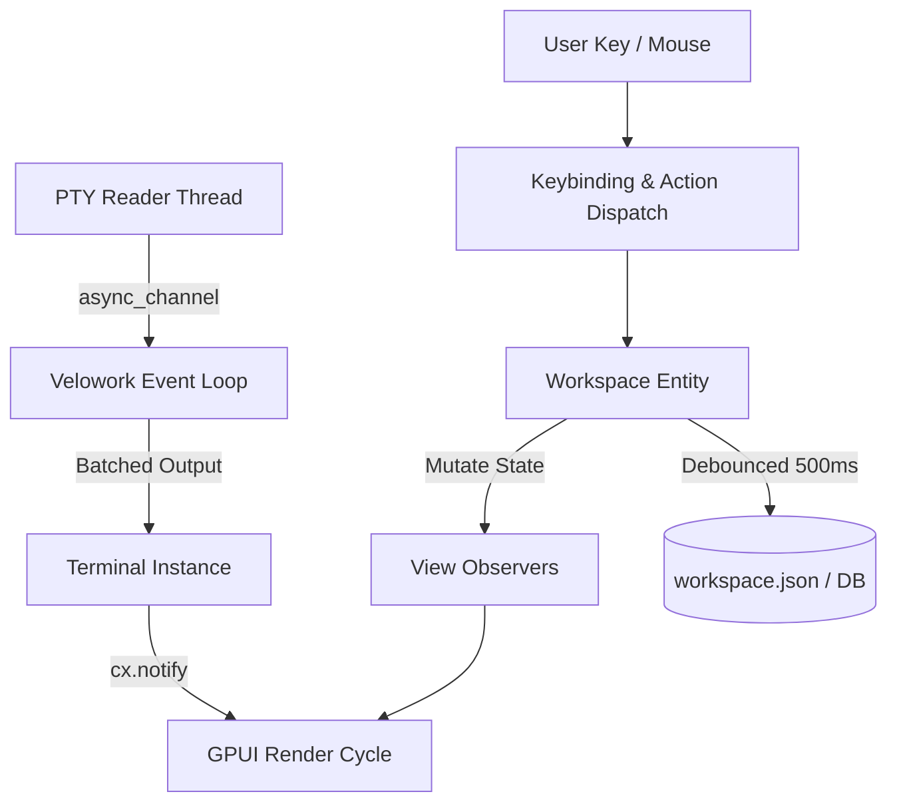

# Velowork App Layer Architecture (`velowork-app`)

The `velowork-app` crate is the desktop UI and application coordination layer. The `velowork` binary is a thin entry point (`src/main.rs`, `src/assets.rs`, `src/smoke_tests.rs`), while the core application logic, views, overlays, and action dispatch reside in `velowork-app`.

---

## 1. Module Structure

```text
crates/velowork-app/src/
├── lib.rs                # Crate root: shim re-exports + module declarations
├── macros.rs             # Shared macros (impl_focusable!)
├── action_dispatch.rs    # Action → workspace dispatch glue
├── logging.rs            # In-app log console (ring buffer + reloadable filter)
├── simple_root.rs        # Linux Wayland maximize workaround
├── soft_close.rs         # Confirm-before-close helpers
├── app/                  # Main application coordinator (Velowork entity)
│   ├── mod.rs            # Top-level entity, PTY event loop, auto-save observer
│   ├── detached_terminals.rs # Multi-window detached terminal manager
│   ├── headless.rs       # Headless runtime mode
│   └── remote_commands.rs # Bridge for remote server commands
├── views/                # GPUI UI views (overlays, chrome, panels, components)
│   ├── overlays/         # Modal dialogs and context menus
│   ├── panels/           # Sidebar, service panel, quick commands, etc.
│   └── window/           # WindowView, titlebar, and main container layout
├── keybindings/          # Keyboard action declarations & configuration
│   ├── mod.rs            # actions!() declarations & register_keybindings
│   ├── config.rs         # KeybindingConfig merge & conflict detection
│   ├── types.rs          # KeybindingEntry serialization models
│   └── descriptions.rs   # Categorized action descriptions for UI help
└── [re-exports]          # Re-export modules for lower-level crates
```

---

## 2. Core Entities & Lifecycle

### GPUI Observable State Model

- **`Velowork`**: Top-level coordinator owning `Workspace`, `WindowView`, `RequestBroker`, and `PtyManager`.
- **`Workspace`**: Root domain model managing projects, folders, layout trees, and focus state.
- **`WindowView`**: Per-window root view managing dock layouts, titlebar, sidebar controller, and `OverlayManager`.
- **`OverlayManager`**: Centralized manager for modal popups, dialogs, and command palettes.
- **`RequestBroker`**: Decoupled event bus for transient UI requests (e.g. opening overlays from background events).
- **`SettingsState`** (in `velowork-app-core`): Reactive settings wrapper with debounced disk synchronization and lock-free thread bridge.
- **`AppTheme`**: Active color palette, font styles, and theme switching coordinator.

### Layered Separation: `velowork-app-core` vs `velowork-app`

To avoid cyclic dependencies and bloated compilation units, domain models, settings states, persistence interfaces, and IPC hooks are isolated in `velowork-app-core`. `velowork-app` depends on `velowork-app-core` and focuses strictly on GPUI view tree assembly, layout calculation, user event routing, and window life-cycles.

### Unsaved Changes Protection (`soft_close.rs`)

`soft_close.rs` provides an application-wide secondary confirmation protocol:
- Any modal or pane implementing dirty-state tracking (e.g., `SessionDialog`, `QuickCommandsModal`, `SettingsPanel`) participates in the `ConfirmClose` pipeline.
- If the user presses `Esc`, clicks the backdrop, or triggers a cancel action while unsaved edits exist, closing is intercepted, and a non-invasive confirmation modal is presented.
- Focus is cleanly restored to the originating control upon cancel, preventing floating focus states.

### Multi-Window Detached Architecture (`detached_terminals.rs`)

Velowork supports popping out any terminal pane or auxiliary tool (such as the in-app Log Console) into standalone OS-level windows:
- Each detached window owns its independent event dispatch and surface renderer while retaining IPC channel bindings to the parent `Workspace` session backend.
- Upon app lock or workspace minimization, detached windows are automatically retracted and safely masked.

---

## 3. Event Flow



1. **PTY Events**: Reader threads stream output chunks through `async_channel` to `Velowork`. The event loop drains pending chunks in batches before notifying the UI thread to avoid rendering bottlenecks.
2. **Action Dispatch**: Keystrokes match context-aware keybindings and dispatch strongly-typed GPUI actions to the focused entity.
3. **State Mutation & Rendering**: Workspace mutations notify observers, triggering reactive view re-renders.
4. **Auto-Save**: State changes trigger a debounced 500ms persist pipeline.

---

## 4. Testing Conventions

Tests in `velowork-app` live in `#[cfg(test)]` modules within source files.

### Key Guidelines
- **Use `#[gpui::test]`** with `gpui` dev-dependency (feature `test-support`).
- Test algorithmic state transitions (layout splits, tree normalizations, tab movements, focus stack operations).
- Avoid testing trivial getter/setter accessors.
- For tests that access global settings, initialize `GlobalSettings` first:
  ```rust
  fn init_test_settings(cx: &mut gpui::TestAppContext) {
      cx.update(|cx| {
          let entity = cx.new(|_cx| SettingsState::new(Default::default()));
          cx.set_global(GlobalSettings(entity));
      });
  }
  ```
