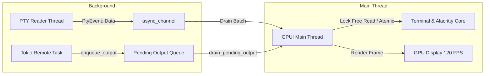

# Velowork Terminal Engine Architecture (`velowork-terminal`)

The `velowork-terminal` crate provides terminal emulation, PTY process lifecycle management, shell environment detection, and session persistence integration.

---

## 1. Core Modules & Files

| File | Purpose |
| :--- | :--- |
| `terminal.rs` | `Terminal` struct wrapping `alacritty_terminal::Term`. Thread-safe buffer access, selection, inline regex search, scrollback management, and URL/file-link detection. |
| `pty_manager.rs` | `PtyManager` managing the PTY process lifecycle. Owns `PtyHandle` instances and spawns background OS reader/writer threads. |
| `shell_config.rs` | `ShellType` enum and `CommandBuilder` construction. Auto-detects local system shells (`bash`, `zsh`, `fish`, `cmd.exe`, `PowerShell`, `WSL`). |
| `session_backend.rs` | `SessionBackend` persistence engine (`dtach`, `tmux`, `screen` on Unix; Windows WSL multi-distro session bridge). |
| `input.rs` | Key-to-bytes translation, DECCKM cursor mode handling, bracketed paste mode, and cross-platform modifier mappings. |
| `process.rs` | Low-level cross-platform process spawning and signal handling. |

---

## 2. Threading & Synchronization Model

Three primary contexts concurrently interact with a `Terminal` instance:

1. **GPUI Main Thread**: Owns UI rendering (`with_content`), user input handling, resize dispatch, text selection, and search. Drains batched PTY events.
2. **PTY Reader OS Thread**: Dedicated background thread per local terminal reading raw PTY bytes and forwarding them through lock-free channels (`async_channel`). Never directly locks the terminal state.
3. **Tokio Remote Task** (Remote/SSH connections): Buffers network packets into `pending_output` and marks the terminal `dirty` without holding `term.lock()`.
4. **Resize Debounce Timer**: Flushes trailing-edge window/split resize geometry to PTY handles.

### Synchronization Primitives

- **`Arc<Mutex<T>>`**: Shared ownership across sub-components (`ZedEventListener`, `OscSidecar`) or background tasks.
- **`Mutex<T>`**: Interior mutability for UI-thread structures.
- **`AtomicBool` / `AtomicU64`**: Lock-free hot-path flags (`dirty`, `content_generation`, `waiting_for_input`, `had_user_input`) preventing mutex contention during 120 FPS rendering.

---

- **`TerminalsRegistry`**: Central thread-safe registry (`Arc<Mutex<HashMap<String, Arc<Terminal>>>>>`) routing PTY events across tabs and splits.
- **Batched PTY Processing**: Instead of processing every byte individually, the event loop drains all currently available data before triggering a GPUI render cycle.
- **Session Persistence Layer**: Transparently wraps terminal commands with `dtach` sockets or `tmux` sessions so sessions remain intact during app restarts or network disruptions.
- **Predictive Local Echo Engine**: To minimize perceived latency over intercontinental or high-jitter SSH connections, typing inputs are immediately predicted and rendered on the local grid with `TCP_NODELAY` network flush, smoothly reconciled with remote server echo packets upon receipt.
- **Hardened ZMODEM Protocol Engine**: Complete streaming pipeline handling `rz` / `sz` protocols with `ESCCTL` character escape filtering, `ZRINIT` pre-negotiation, and an asynchronous Cancellation Drain Loop that consumes residual trailing bytes to prevent PTY deadlock or display corruption upon user cancellation.
- **Structured Command Output Capture**: Intercepts shell execution boundaries and prompt escapes to segment terminal history into semantic blocks, supporting instant selection, copy, and inline AI context referencing.

